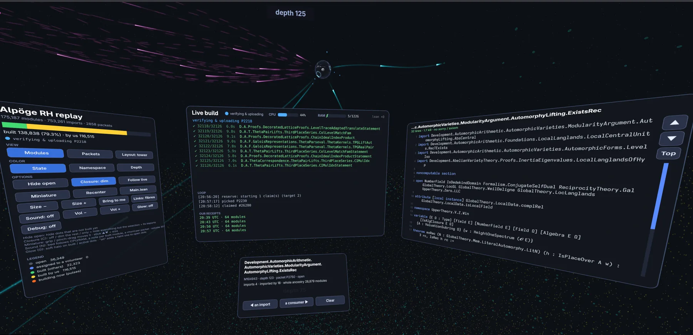
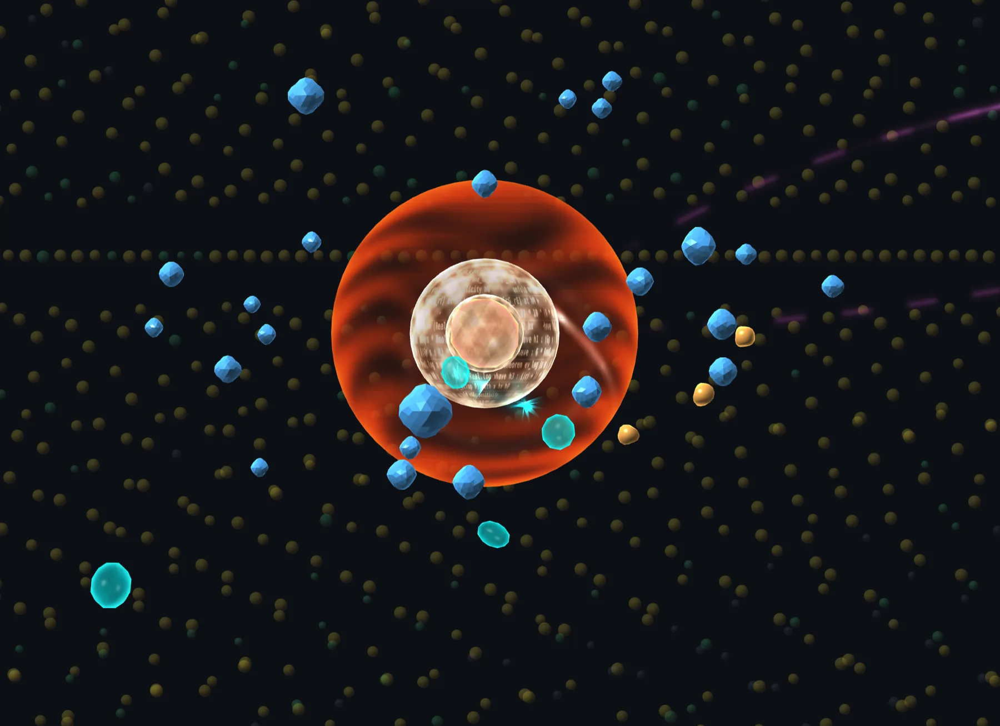
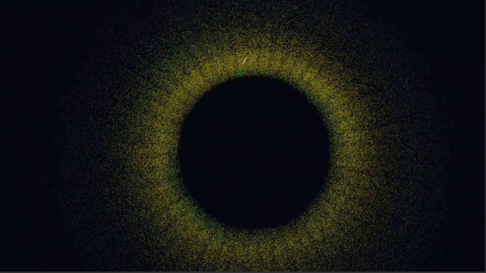
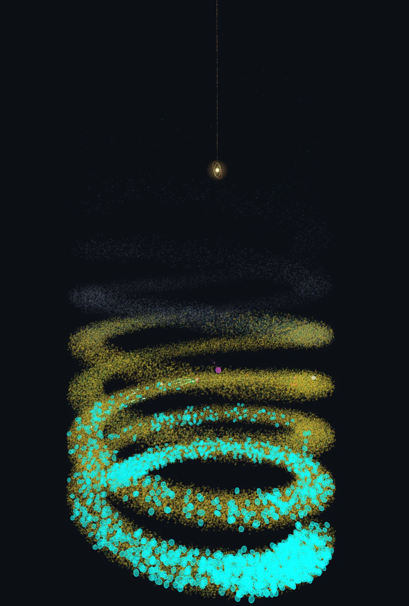
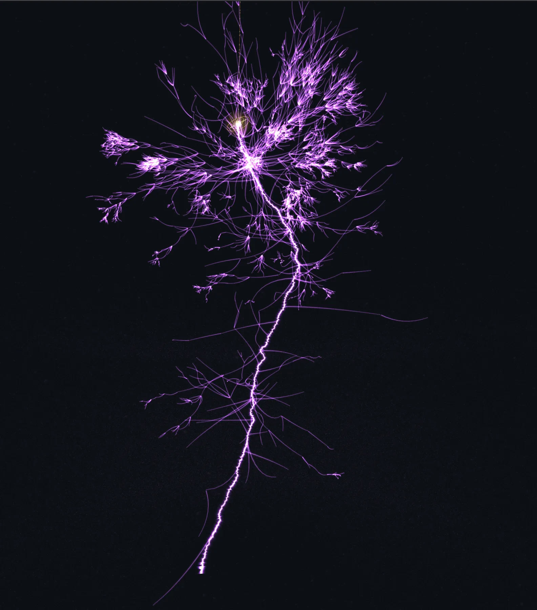
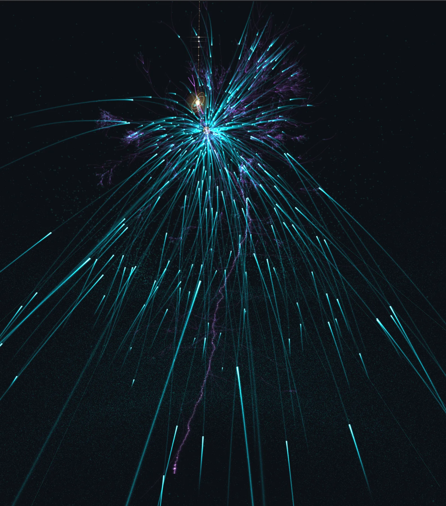
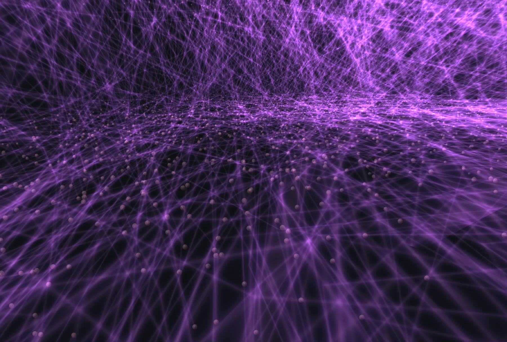

# VRiemann – the RH proof replay, live in 3D and VR

A visualization of the Lean verification of Alpöge's RH proof ([alpoge-rh-replay](https://github.com/rohanarun/alpoge-rh-replay)):
175,187 modules in 3D, height = import depth (Main on top): a tower of rings (the default), a double / ×4 / ×8 helix, a miniature on a table, or the 2,858 packets as spheres. Everything is read locally – no GitHub requests.

<i>The real Lean source of every module is readable in the scene (right), next to the live build log of the replay (middle).</i>

<b><a href="docs/GALLERY.md">More in the gallery →</a></b>

## Quick start
Needs only Python 3 (standard library, no packages; tested with 3.14) and a modern browser. Works offline after the clone.

    git clone https://github.com/rohanarun/alpoge-rh-replay ~/DEV/alpoge-rh-replay   # the module index the tower is built from
    git clone https://github.com/hipotures/vriemann ~/DEV/vriemann
    cd ~/DEV/vriemann
    python3 build_graph.py      # once (and after the index changes): writes the 3D layouts to data/ (a few seconds)
    python3 build_spine.py      # optional, needs the Lean sources (--vol): the "spine" layout (~40 s)
    python3 server.py           # then open http://127.0.0.1:8080/ in the browser

Cloned the replay repo somewhere else? Pass `--repo <path>` to both commands.

**Optional live data.** Without anything else you see the whole tower with the public build status from the index. These extras light up more panels:

| Path (option) | What it adds |
|---|---|
| `~/rh-replay-vol/lean/src` (`--vol`) | the Lean source code on the code sphere and in the source panel (a volume prepared with `./verify.sh <dir> --prepare-only` from the replay repo) |
| `~/rh-receipts/*/build.log`, `receipt.json` (`--receipts`) | modules you built yourself (gold) and the live build log |
| `~/rh-tools/packet.log` (`--packet-log`) | the state of a build loop (claiming, building, uploading) in the menu |

**Other devices and VR headsets.** `python3 server.py --host 0.0.0.0` makes it reachable on your network (http://<your-ip>:8080/). WebXR (the VR button) needs HTTPS:
either put the server behind a reverse proxy that terminates TLS, or give it a certificate directly:

    python3 server.py --host 0.0.0.0 --cert fullchain.pem --key privkey.pem   # https://<host>:8443/

A-Frame 1.7.0 (three.js r173) is vendored in `vendor/`, so no CDN is used. The server never contacts GitHub.
The source panel uses **Iosevka Fixed** (narrow monospace, SIL OFL 1.1, `vendor/fonts/`), subset to the characters that occur in the Lean sources (23 kB woff2);
a few script capitals such as 𝓞 fall back to the system font. Each character gets its own grid cell, so a fallback glyph never shifts the rest of the row.

## Other proofs: GRH
The **PROOF** row at the top of the menu switches between the RH replay and any other Lean proof added with `add_proof.py`, for example
the [GRH proof](https://github.com/hipotures/grh-lean) in its two editions (readable: 803 modules, compact: 794):

    git clone https://github.com/hipotures/grh-lean ~/DEV/grh-lean
    python3 add_proof.py grh ~/DEV/grh-lean/grh --title "GRH in Lean 4 (readable)" --label GRH
    python3 add_proof.py grh-compact ~/DEV/grh-lean/grh-compact --title "GRH in Lean 4 (compact)" --label "GRH compact"

Each takes a few seconds and writes `proofs/<key>/` (index, a link to the sources, layouts and spine; not in git); restart `server.py` and it finds
them. Switching reloads the page with `?proof=<key>` (in the headset: enter VR again). Height is the project-internal import depth (Mathlib does not
count), stretched so every proof stands about as tall as the replay; the **packets** are the project's folders; every module is green
(machine-checked), there is no live build, receipts or loop status for these proofs. The spine starts at `riemannHypothesis` in `Main` like the
replay's; with GRH it runs `grh → … → star_inequality → integral_forms_long → …` down to the foundations (54 steps readable, 39 compact).

## Controls
Desktop: drag = look around, WASD = move, Q/E = elevator (depth), click = select / press a button (click into empty space = deselect), wheel over the code = scroll (in the miniature: size),
**B or M** = tower ⇄ miniature, **X** = follow live (off → camera → in place), **H or Y** = hide/show the UI, **R** = panels in front of me (A is "left", so recenter is R). **K** = connection style (fibres / tubes), **I** = debug letters, **+ / −** or Shift+wheel = zoom (0 = reset).
VR (Touch controllers): trigger = select / button, left stick ▲▼ = elevator, right stick ◀▶ = rotate the world, right stick ▲▼ over the code = scroll,
A = put the panels in front of me, B = tower ⇄ miniature on a table, X = follow live, Y = panels off (beams stay) → everything off (beams too) → everything on.

A-Frame's **F** shortcut ("enter VR", which on a desktop without a headset only goes fullscreen) is switched off. VR mode means the headset is really presenting (`renderer.xr.isPresenting`), so a fullscreen browser keeps the mouse, the desktop menu and no controller beam.
In the headset the menu leaves out the keyboard help (only warnings such as blocked sound remain); on the desktop the key hint sits on a dark backing.

## Recording, miniature, hands
- **H or Y** (keyboard) – hides/shows the whole interface: panels, labels, hint and VR button. **Y** (left controller) cycles three states: panels and labels off but the controller beams stay (to aim at things without the panels in the way) → everything off, beams too (for recordings) → everything on.
- **Miniature** (B / M): the tower on a table. **Grip** on a controller or a **pinch in empty space** with a hand grabs it to move/rotate it;
  right stick ▲▼ (desktop: wheel) changes its size; **Bring to me** slides the tower's axis into your head (at the height of the selected module) –
  the points surround your head up close. The "depth" labels flip by themselves: readable from outside when you are outside, from inside when inside.
- **Hands**: without controllers you see your hands (hand tracking); aiming = a ray from the shoulder through the index fingertip, pinch = click.
- **The selected module** is a living sphere: a full surface with flowing bands and one "comet" per import (speed grows with the CPU of the `lean` process
  compiling that module right now); the core pulses and grows with memory (RES = resident size, mostly shared Mathlib .olean files);
  time/CPU/RES are in the Live build panel, there is no text over the sphere. The middle sphere carries the module's **Lean code** on its surface and pulses
  (faster with CPU, slowly enough to read). The small **nucleus** inside shows the **estimated compile progress**: Lean reports no progress within a module, so the server
  estimates the expected time from the file length with a power law fitted to every module we have built (90th percentile: ~94% finish before it runs out). The nucleus grows
  from a seed to full size, **breathes slowly when a module runs past its estimate**, flashes once when the module is built, and stays full for built modules. **Declarations from the code** orbit around it (theorem/lemma/def/instance/axiom; size = length, `axiom` in red) –
  **clicking a satellite scrolls the code to that declaration** and highlights it.
  Changing the selected module is a **smooth hand-over**: the new sphere appears in ~0.4 s, the old one lingers ~1.2 s, fading and collapsing into its centre, and a soft arc with a travelling point (~1.1 s) "hands over" attention, slow enough for the camera to follow. Every jump leaves its own arc that fades over ~6 s, so quick jumps leave a fading web of the path (up to 16 arcs; `FADE_SEC`, `OUT_SEC`, `LINK_SEC`, `LINK_RUN`, `LINK_N` in `app.js`).
- **Live build** panel: machine CPU and RAM bars plus the number of `lean` processes, so you can see that work is happening.

## Sound (off by default)
Generated live (Web Audio, no files), toggled with the **Sound** button in the menu or the **N** key (browsers only play after a click).
Three quiet layers: a **bed** (a slow low "breath": brighter with CPU, deeper with memory), **a note for every built module** (pentatonic scale, deeper = lower,
in VR it comes from the module's place in the tower; thinned to ~4 per second, max 10 at once) and a rare **chord** when one of our packets finishes.
Turning it on plays a **two-note confirmation**, and changing the volume plays a short blip, so you know at once whether it works. When the browser keeps audio suspended until the first gesture, the button shows **"Sound: tap"** and why;
every click / key / controller trigger retries. Default levels: notes about −22…−19 dBFS, bed −40 (idle) … −28 (load); a test keeps them from drifting back to inaudible.
All tuning numbers are at the top of `static/audio.js` (`CFG`): volume, density, brightness, decay, reverb. The browser remembers the volume.

## Layout: tower, helix or spine
The **Layout** button in the menu (or the **L** key) cycles the layout: tower (rings) → double helix (like DNA) → ×4 → ×8 → spine. Height is still import depth (Main on top), so the elevator, rulers
and the Main marker work the same; **strand = namespace** (balanced by size, big namespaces split by packet), each strand is a right-handed helix of radius 6 m,
and the modules sit in a tube of radius ~0.9 m around it. The layouts (`data/pos_helix{2,4,8}.f32`) are generated by `build_graph.py` and loaded on first use (2 MB). The transition is smooth (1.6 s).

**Spine**: the proof as a lightning tree of *declarations*, not modules. The **trunk** is a chain from `riemannHypothesis` (Main, on top)
down to the foundations, each step a declaration named in the proof of the one above it (`rhOfAll → allChi → everyCharacter → …`, ~60 steps);
**branches** are a sample of the lemmas each step names, up to four levels; **dust** is every module the tree never reaches (dimmed, around it).
The tree stands 12 m in front of you (not around your head); rotating the world (right stick ◀▶) walks you around it, the elevator moves along it.
It is drawn as one additive ribbon mesh (violet haze, pink body, white-hot core; a flash runs down the whole tree every 14 s), with small labels
(constant size on screen) on the root, every 6th trunk step and a few branches. **Every branch is clickable**, anywhere along its arc: it lights up
with everything hanging from it (the rest dims), selects the module its declaration lives in and scrolls the source to that declaration; a click
on the trunk lights that step with the lemmas branching off it. The info panel names the branch; Clear, another module or a click into empty space drops it. The dust is not clickable in the spine (it is everywhere).
**Closure** (C) works in the spine too: off = all dots, dim = the dots fade out of the way, only = **the bare tree** without any dots (with a selection: the tree plus the selection's closure). The modules move onto their first node like in any other layout.
**Three levels** (the **SPINE** row in the menu, or **P**), all with the same trunk; the dots that are not on a level's tree stay where they are (the dust):
**Skeleton** (~1,000 declarations in ~380 modules: a sample of the lemmas each step names, 4 levels deep), **Dense** (~5,800 declarations in ~2,000
modules: up to 10 levels, all the project-internal lemmas the sources name; the rest of the names point into Mathlib) and **Full** (every one of the
175,187 modules, each hung under the module importing it that is closest above in import depth, its height = import depth along the trunk; ribbons
are drawn only for the trunk and three levels of branches, ~240; the other modules are dots on their spots, clickable). L from any level goes on to the tower.
**Wind** (the button next to the levels, or **V**): the tree hangs from `riemannHypothesis` like a willow, every node a joint that carries
its parent's sway and adds a little of its own, so the tips move most (well under a metre); the module dots and labels ride along. It eases
in slowly and calms while you point at or have selected something, so picking hits what you see. Remembered between sessions.
It needs `python3 build_spine.py` once (reads the Lean sources of the volume, `--vol`; ~1 min), which writes `data/pos_spine*.f32`, `spine*.json` and `spine*.bin` for the three levels;
without them L skips the spine. The dependency graph is approximate (a declaration's text up to the next one, identifiers resolved by short name
to the same module, a direct import, or a transitively imported module). Tune the look with `SPINE` in `app.js`, the shape with the constants at the top of `build_spine.py`.

## Connections (fibres or tubes)
**Fibres** (default): every connection of the selected module is a faint, glowing light-guide along a cubic arc that **leaves the core radially** (fanned out, so
many connections sprout like a dandelion instead of one bundle) and then curves into its neighbour. **Comets** (bright head, short tail) run the way knowledge flows.
**Imports** (cyan) get dense, fast comets flowing INTO the core, and every arrival makes a **ripple on the core's membrane** where the fibre docks.
**Consumers** (magenta) are thin, dim, dashed threads with a rare slow wave going OUT, so they do not compete with the imports.
Fibres are additive (overlaps add up to a glowing trunk instead of a solid wall), have a soft Gaussian profile (no hard, aliased edge), fade at both ends and with distance,
and each has its own pace. Tune them with `FIB` in `app.js` (`segs`, `width`, `minPx`, `speed`, `freq`, `conSpeed`, `docks`).

**Tubes** (**K** or the **Links** button in the menu toggles; the browser remembers the choice): lit, opaque 3D tubes that hide each other like objects, thin where they leave the core,
with a bright bulge travelling along them. Tune them with `RIB` (`segs`, `sides`, `width` = radius, `start`, `minPx`, `speed`, `freq`).

Both styles draw up to `RIB.max` = 192 connections (all of them for ~99.8% of modules); only for hubs is the remainder a faint haze of thin lines.

## Glow
The **Glow** button in the menu or the **G** key: off → on (a soft halo around built / assigned / ours / compiling points) →
"all" (also a faint halo around grey, still-open points; heavy for a headset GPU). The halo is the same geometry drawn a second time, larger and additive – no
data copy. Strength and size are tuned in `GLOW` at the start of the glow section in `app.js`. The browser remembers the choice.

## Main and the critical line
Main (the final theorem, depth 202) has a golden landmark: a star, three turning rings and a corona. Above it rises the **critical line**: a thin warm line with the
**first 30 non-trivial zeros of zeta** on it, at heights proportional to their imaginary parts (14.13, 21.02, 25.01, …, 101.32), so they get denser upwards like the real ones.
Like the sequenced approach lights of a runway (or an obstruction light for passing mathematicians), a blink runs up the line every 6 s, faster and faster, and each zero
flashes with a short horizontal flare as it is passed. Tune it with `ZERO` in `app.js` (`y0`, `span`, `sweep`, `cycle`, `decay`).

## What you see
Colours: grey = open, blue = assigned to someone, green = built (by others), gold = built by us, pulsing orange = building right now.
**Closure** (button or **C**) has three modes: off → *dim* (everything else dimmed to 22%) → *only* (everything else disappears, leaving the selection and its imports).
Selected module: the whole chain of its imports (cyan), direct consumers (magenta), Lean code with highlighting (`sorry`/`axiom` in red).
Every module is normally a dot shaded like a ball (a camera-facing sprite: cheap, but flat if you put a controller through it). The **connected modules** (imports / consumers of the
selection) and the **compiling** ones are instead real 3D **soap bubbles**: instanced ellipsoids with a see-through middle and an iridescent rim, which slowly tumble and squeeze in all
three axes (volume kept). They have real depth, so a controller cuts them like solid objects. Smooth spheres (24×16), up to `SOLID.max` = 4,000 at once (compiling ones first, then the connected nearest to the
selection); beyond that the rest stay plain dots. Each bubble has its own tempo and phase (shape periods ~5–16 s, compiling ones beat every ~2–3.5 s), so they never pulse in step. Tune them with `SOLID` in `app.js` (`max`, `segs`, `rings`, `minPx`, `wobble`, `tempo`, `liveSize` = size of the compiling bubbles).
The "Packets" view = 2,858 packets as spheres (colour = % built). "Follow live" (X) cycles off → **camera** (selects the module that has been compiling the longest and takes you there: elevator + turning the tower) → **in place** (the scene stays still, only the selection moves: each new module gets its core, links and code where it is) → off. A manual selection turns follow off.

## Debug letters
The **Debug** button in the menu (or **I**) puts a one-letter label next to each kind of active object, so you can say "object E looks wrong".
The passive dots (open / assigned / built modules not connected to the selection) are never labelled. With debug on, the menu shows the legend:

| Letter | Object |
|---|---|
| A | core membrane (outer shell, docking ripples) |
| B | code sphere (Lean code on it) |
| C | nucleus (compile progress) |
| D | declaration satellite (orbits the core) |
| E | import bubble (cyan) |
| F | consumer bubble (magenta) |
| G | compiling / just built bubble |
| H | import fibre / tube |
| I | consumer fibre / tube |
| J | hair line (links beyond 192) |
| K | hand-over arc (selection change) |
| L | Main landmark (star, rings) |
| M | zeta zero on the critical line |
| N | hover marker |

Labels keep the same small size on screen while zooming. Only a few of each are labelled (the 24 bubbles nearest to you, 10 satellites, 6 import and 4 consumer links, 3 zeros); tune it with `DEBUG` in `app.js`.

## Gallery
Screenshots live in `docs/gallery/` as small WebP files, described in `docs/gallery/gallery.json`; `docs/GALLERY.md` is generated from it.
Add new ones with (needs Pillow; panoramas are stacked automatically, other shots of one group sit side by side):

    python3 tools/gallery.py add "Title" "One caption for the group" shot1.png [shot2.png …] [--slug name]
    python3 tools/gallery.py build      # after editing gallery.json by hand

## Tests
    node tests/test_lib.js                                   # logic on the real data
    python3 tests/test_phase.py                              # build-loop phase detection
    node tests/test_audio.js                                 # sound engine with a fake AudioContext
    NODE_PATH=<…/node_modules with three@0.173.0> node tests/smoke_app.js [http://127.0.0.1:8080]   # app.js without a browser, against a running server
    PROOF=grh NODE_PATH=<…> node tests/smoke_app.js [http://127.0.0.1:8080]           # the same for a proof from add_proof.py (its own short suite)
Not tested: GLSL rendering and real controllers (they need a browser / headset).
