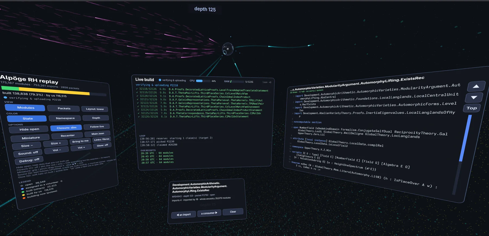
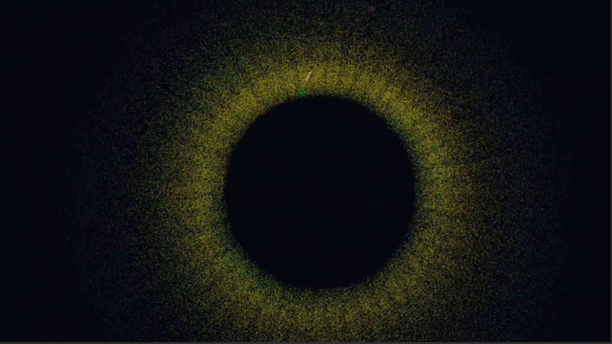
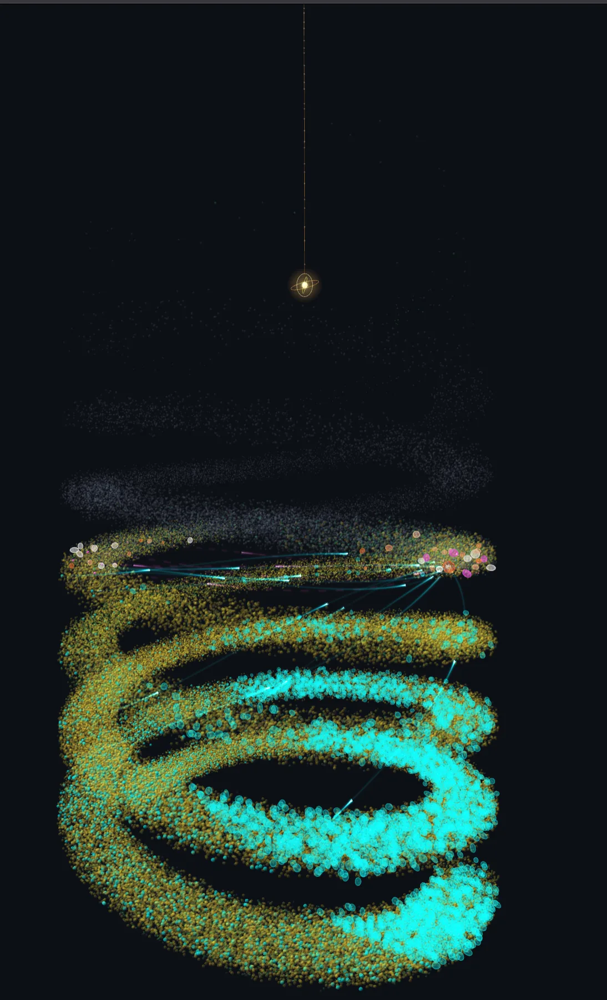

# Gallery

Screenshots from the desktop browser (VR captures will follow). Images in one row show the same scene from different moments or angles.

## The whole interface

The menu with the build progress (left), the live build log of our machine (middle), and the Lean source of the selected module (right), with the module itself and its import fibres floating in the tower. Everything updates while the proof is being replayed.

## A module up close

The selected module: an orange membrane, a sphere carrying its Lean code, a nucleus that grows with the estimated compile progress, and blue satellites for its theorems and definitions. Cyan fibres bring in its imports (with comets flowing into the core); connected modules are soap bubbles.

 

## The Eye of Riemann

Looking straight down the axis of the tower: 175,187 modules, ring after ring, form an eye around the empty centre.

## The proof as a helix

The helix layout: height is import depth, each strand a namespace. Built modules are gold, the connections of the selection cyan; above the tower, Main (the final theorem) with the critical line and the first zeros of zeta.

 

