# Gallery

Screenshots from the desktop browser (VR captures will follow). Images in one row show the same scene from different moments or angles.

## The whole interface

The menu with the build progress (left), the live build log of our machine (middle), and the Lean source of the selected module (right), with the module itself and its import fibres floating in the tower. Everything updates while the proof is being replayed.

<a href="gallery/interface-2.webp">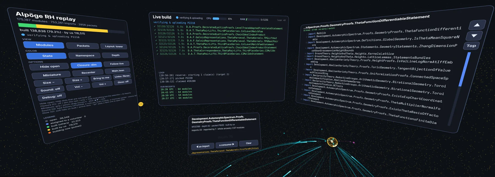</a>

## A module up close

The selected module: an orange membrane, a sphere carrying its Lean code, a nucleus that grows with the estimated compile progress, and blue satellites for its theorems and definitions. Cyan fibres bring in its imports (with comets flowing into the core); connected modules are soap bubbles.

<a href="gallery/module-1.webp">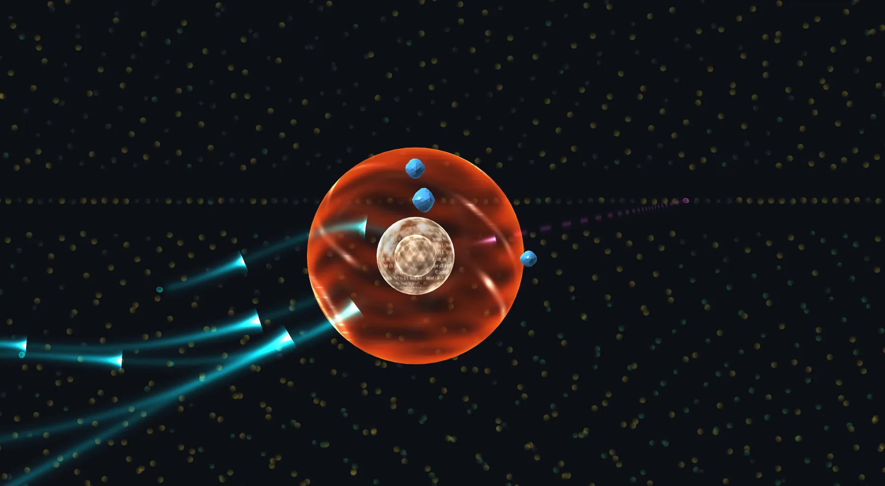</a> <a href="gallery/module-2.webp">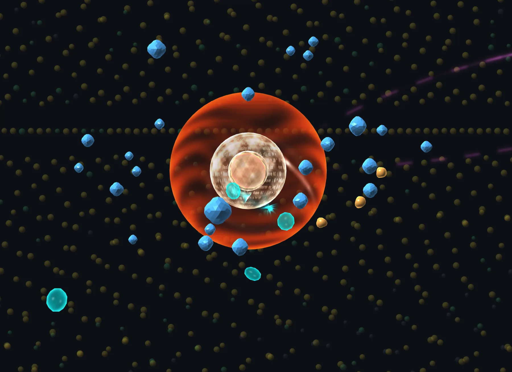</a>

## The Eye of Riemann

Looking straight down the axis of the tower: 175,187 modules, ring after ring, form an eye around the empty centre.

## The proof as a helix

The helix layout: height is import depth, each strand a namespace. Built modules are gold, the connections of the selection cyan; above the tower, Main (the final theorem) with the critical line and the first zeros of zeta.

 <a href="gallery/helix-2.webp">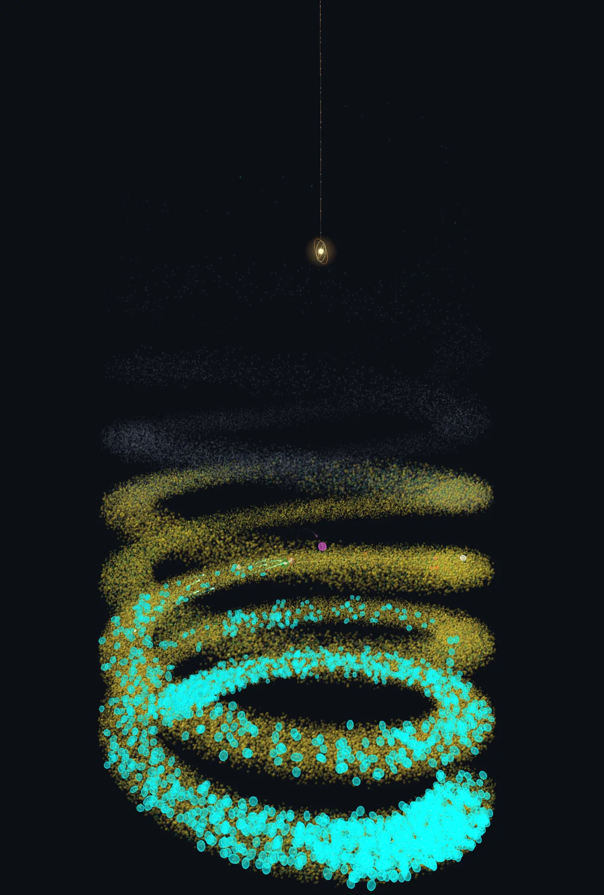</a>

## The proof spine

The spine layout: the trunk is a chain of declarations from riemannHypothesis down, each named in the proof of the previous one; the branches are the lemmas each step names, the dots that fall off the tree are the dust. Left: the bare tree (Closure: only); right: a module on the tree selected, its imports in cyan.

<a href="gallery/spine-1.webp">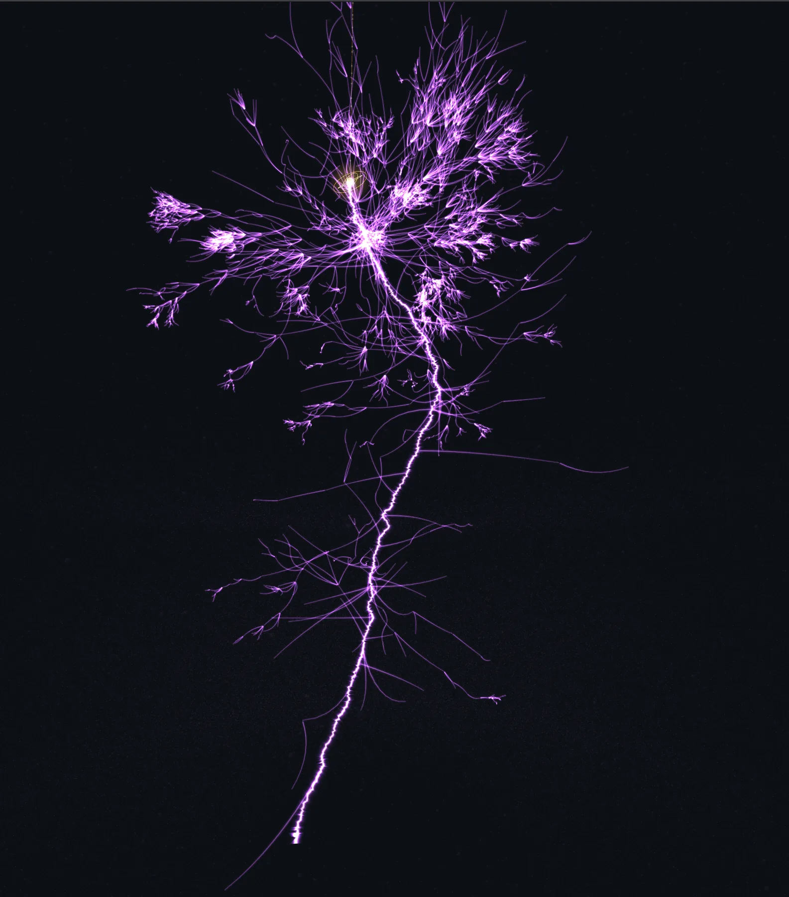</a> <a href="gallery/spine-2.webp">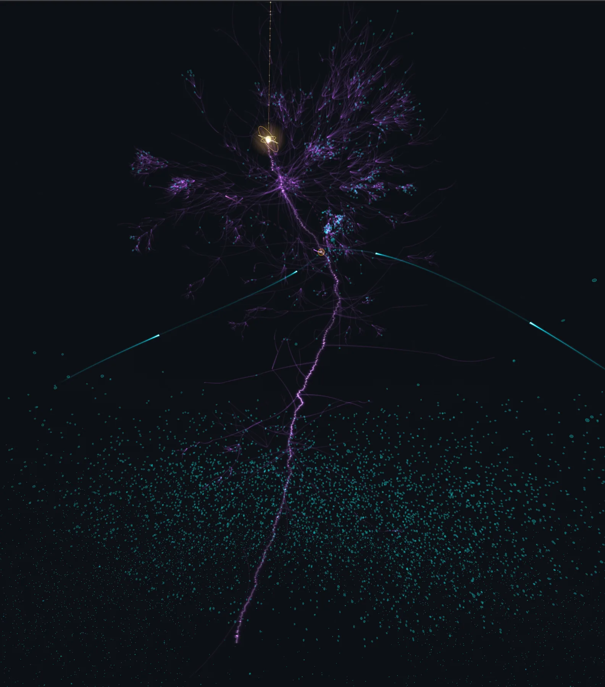</a>

## Connections in the spine

Selecting modules on the trunk: the cyan fibres bring in their imports, the magenta ones lead to the modules that use them, all crossing the lightning tree.

<a href="gallery/spine-links-1.webp">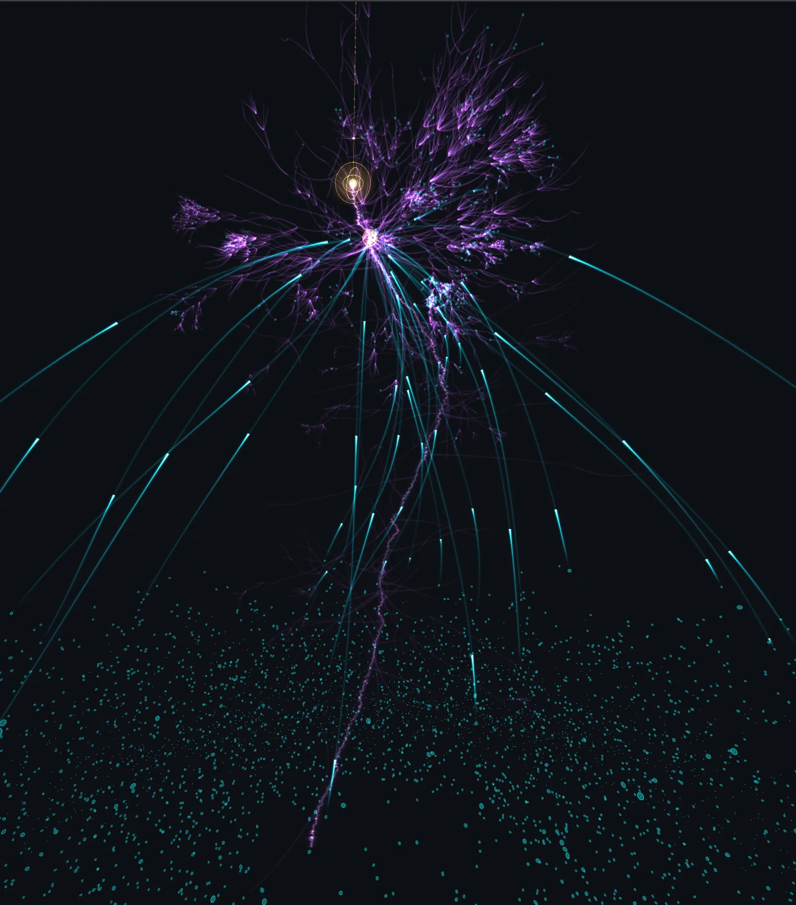</a> <a href="gallery/spine-links-2.webp">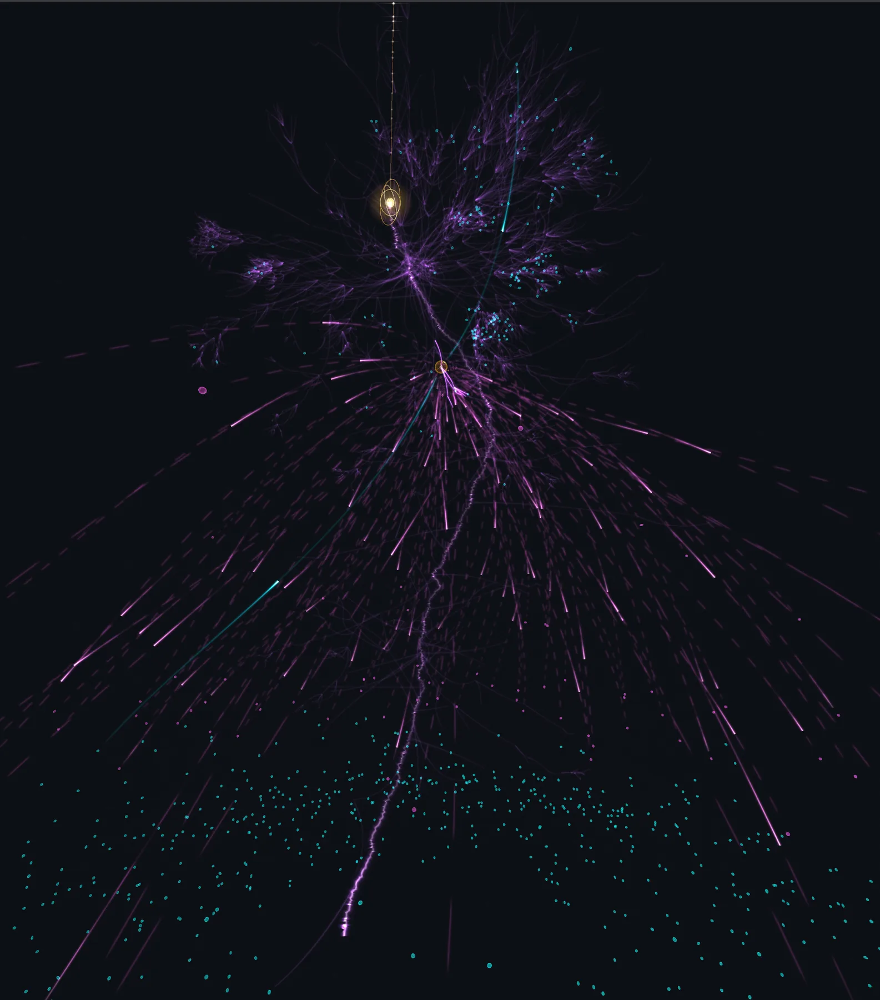</a> <a href="gallery/spine-links-3.webp">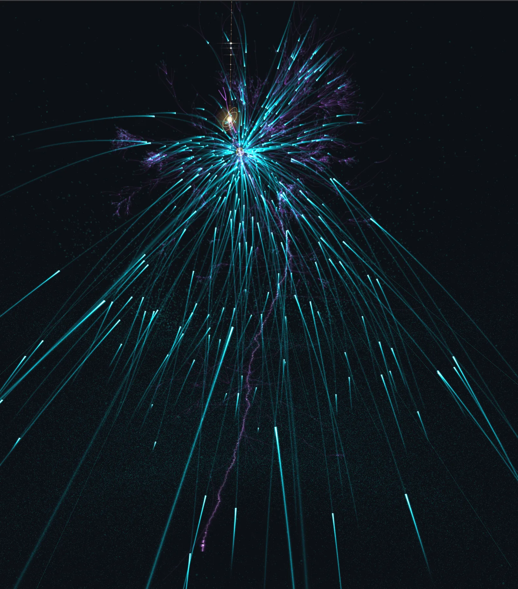</a>

## Inside the full spine

An early version of the full level, with a branch for every one of the 175,187 modules: looking down the trunk into the white-hot core, and up close among the branches. (Too heavy for the browser; the full level now draws ribbons only for the trunk and three levels of branches.)

<a href="gallery/spine-full-1.webp">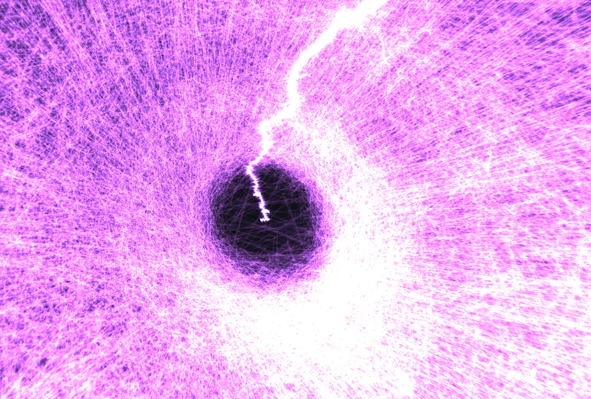</a> <a href="gallery/spine-full-2.webp">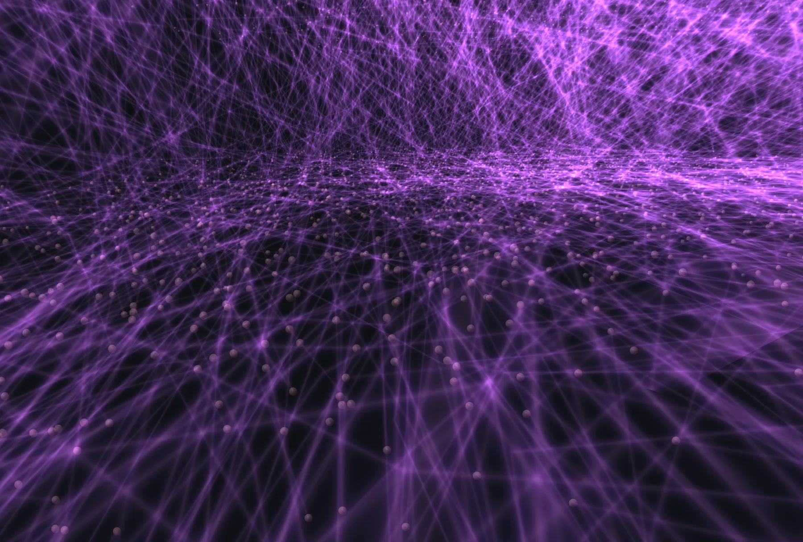</a>

